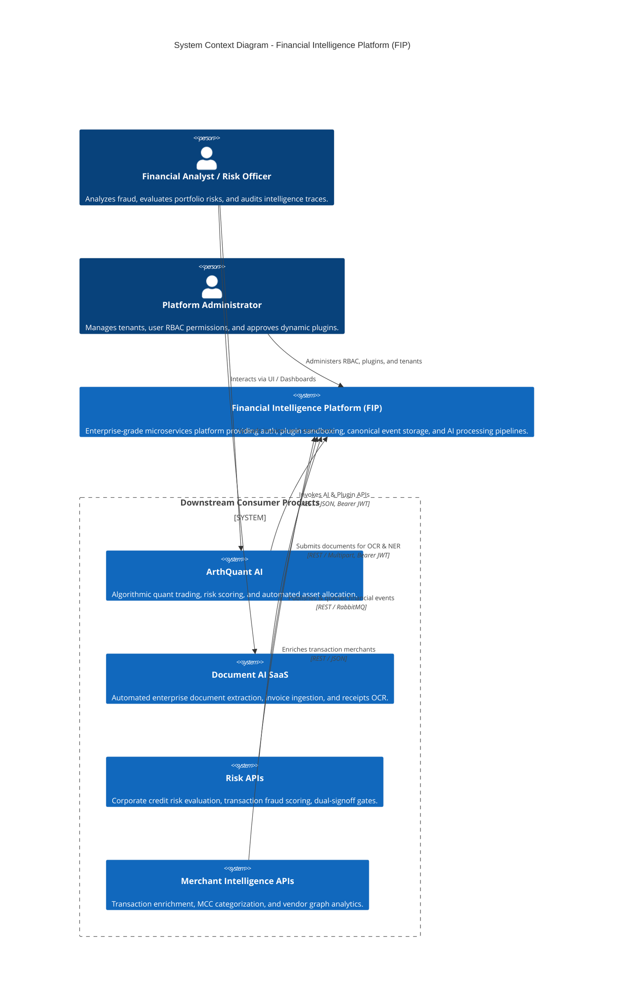
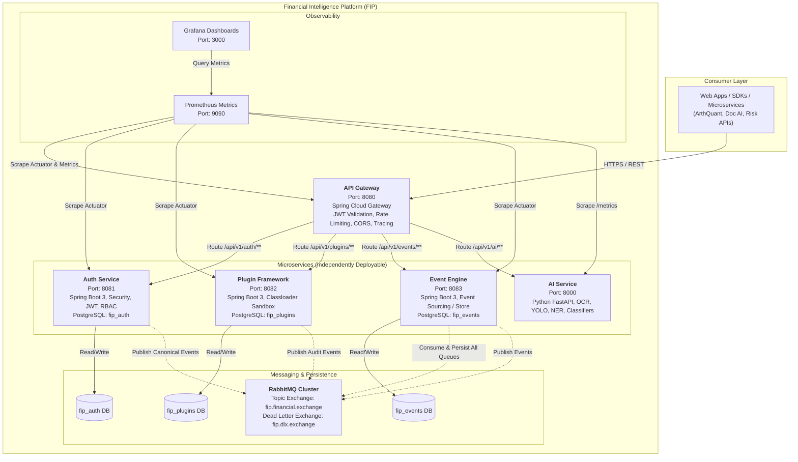

# C4 System Architecture - Financial Intelligence Platform (FIP)

## 1. System Context Diagram (C4 Level 1)

The Financial Intelligence Platform (FIP) serves as the core foundational engine for diverse fintech products. FIP is domain-agnostic and enforces clean separation: product-specific applications consume FIP APIs without product logic leaking into the platform.

---

## 2. Container Diagram (C4 Level 2)

