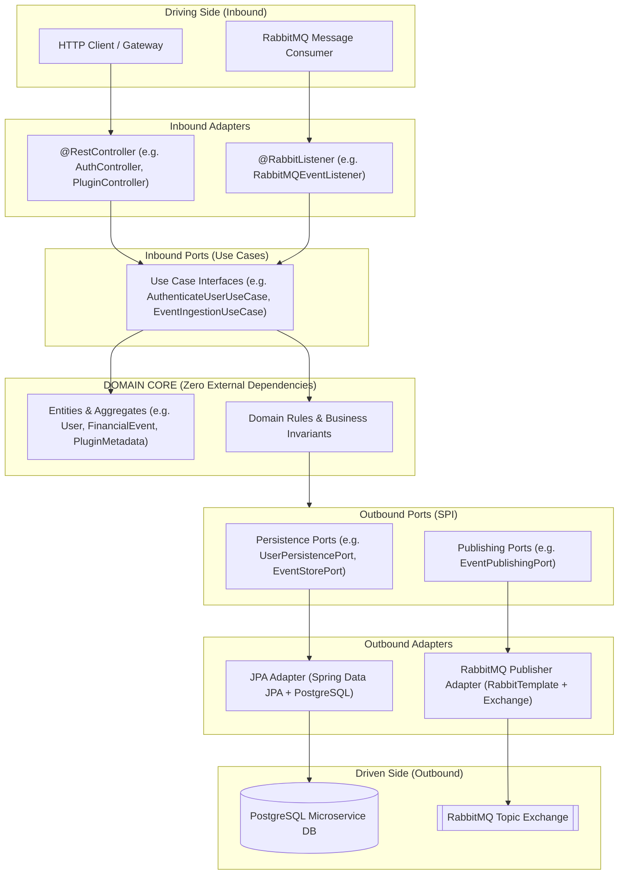

# Hexagonal Architecture (Ports and Adapters) & Domain-Driven Design (DDD)

## 1. Architectural Philosophy

Every microservice in the Financial Intelligence Platform strictly implements **Hexagonal Architecture** (Cockburn, 2005) coupled with **Domain-Driven Design (DDD)** principles:

1. **Pure Domain Core**: Contains domain entities, aggregates, and domain invariants. It has **zero dependencies** on external frameworks, Spring, JPA, Hibernate, or HTTP libraries.
2. **Ports (Interfaces)**:
   - **Inbound Ports (Driving Ports / Use Cases)**: Define what the application can do (e.g. `CreateUserUseCase`, `PluginLifecycleUseCase`, `EventIngestionUseCase`).
   - **Outbound Ports (Driven Ports)**: Define what external capabilities the application requires (e.g. `UserPersistencePort`, `EventStorePort`, `PluginEventPublisherPort`).
3. **Adapters (Implementations)**:
   - **Inbound Adapters (Driving Adapters)**: REST Controllers, RabbitMQ Event Listeners. They convert HTTP/JSON or AMQP payloads into command records and invoke Inbound Ports.
   - **Outbound Adapters (Driven Adapters)**: Spring Data JPA repositories, MapStruct entity mappers, RabbitTemplate message publishers. They implement Outbound Ports.



---

## 2. Inversion of Control & Dependency Rule

Dependencies strictly point **inward** toward the domain core:
```
Adapters In  ──> Inbound Ports ──> Domain Core
Adapters Out ──> Outbound Ports ──> Domain Core
```
- A change to PostgreSQL, Flyway, or RabbitMQ never impacts the business logic.
- Domain models are POJOs / Records without JPA annotations (`@Entity`, `@Table`).
- JPA entities are confined strictly to `adapters/out/persistence`.
- MapStruct handles bi-directional boundary mapping seamlessly.
