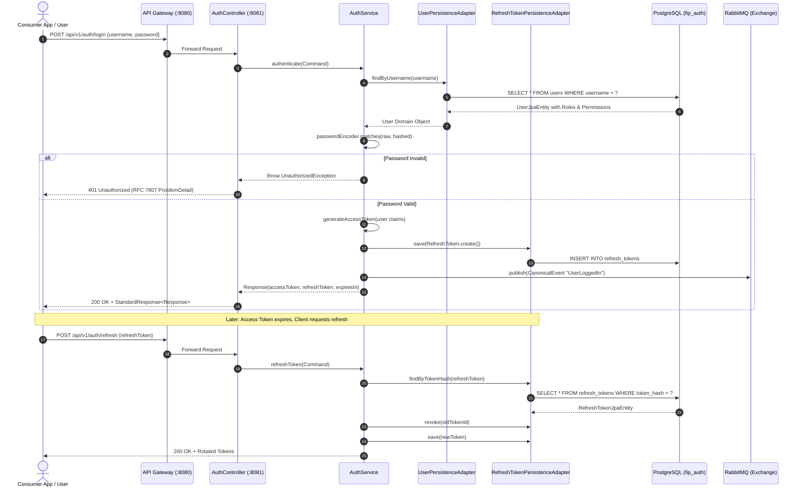
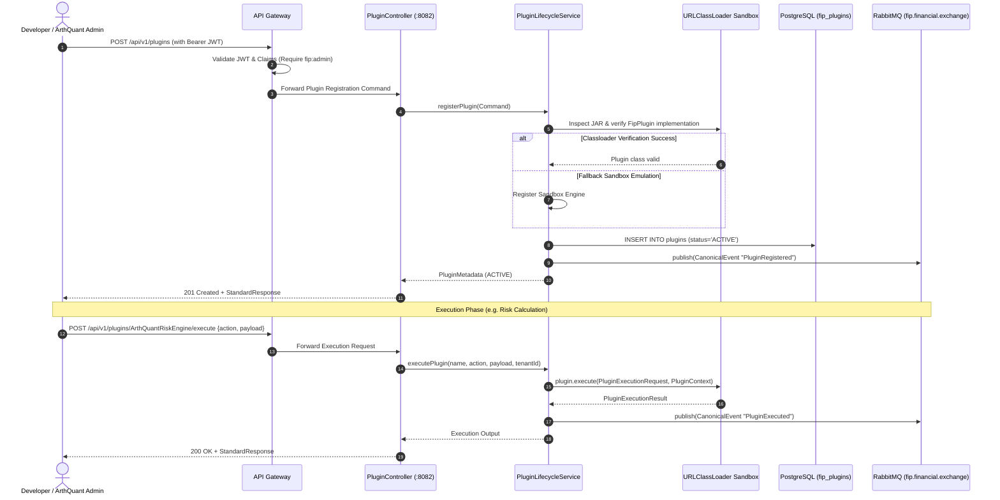
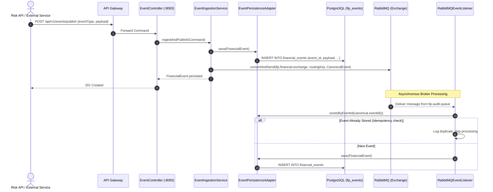
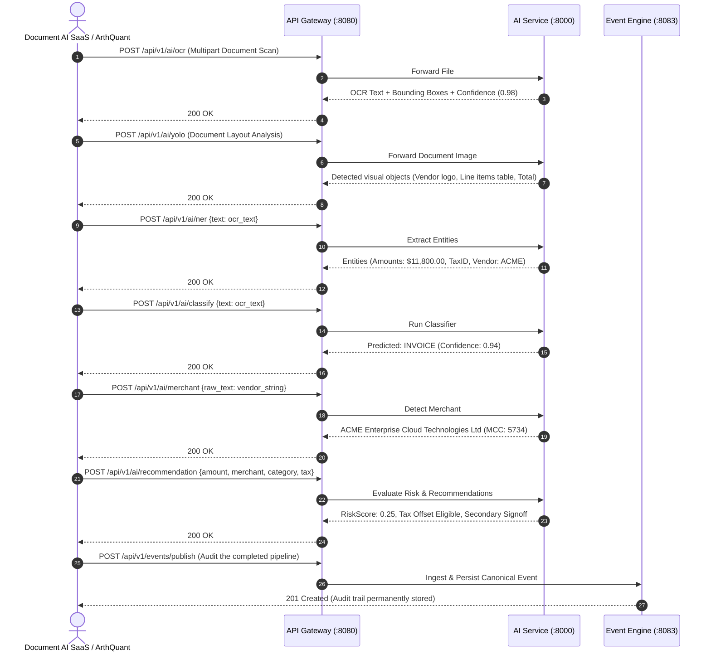

# Financial Intelligence Platform (FIP) - Sequence Diagrams

## Sequence 1: Authentication & Token Rotation Flow

Demonstrates login credential validation, JWT access token generation with embedded RBAC claims, and refresh token rotation.

---

## Sequence 2: Third-Party Plugin Registration & Sandboxed Execution Flow

Demonstrates dynamic plugin registry, bytecode verification, and safe sandbox invocation.

---

## Sequence 3: Financial Event Ingestion & Audit Pipeline Flow

Demonstrates asynchronous event ingestion, deduplication (idempotency), persistence in the Event Store, and broadcast distribution.

---

## Sequence 4: End-to-End Financial Intelligence Pipeline (ArthQuant / Document AI)

Demonstrates how downstream products consume the modular AI services without any product logic living in the platform core.

