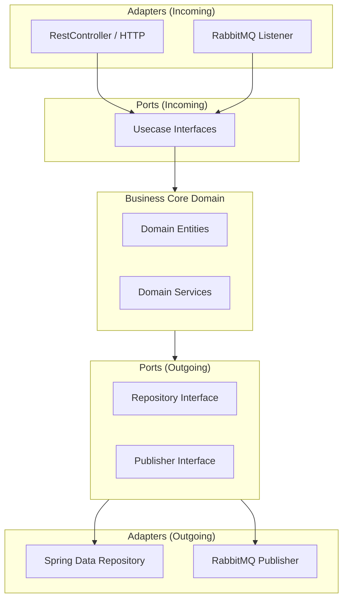

# Financial Intelligence Platform (FIP) - Architectural Documentation

This document explains the core architectural patterns, design standards, and system components of the Financial Intelligence Platform.

## 1. Architectural Patterns

### Hexagonal Architecture (Ports and Adapters)
To ensure the core business rules of the platform are completely decoupled from databases, frameworks, messaging brokers, and communication layers:
- **Core Domain**: Houses the business logic and rules. It has no dependencies on Spring, JPA, or web frameworks.
- **Ports (Input/Output)**: Interfaces defining the communication boundary.
  - *Input Ports*: Usecases called by incoming adapters (e.g. controllers).
  - *Output Ports*: Implemented by outgoing adapters (e.g. persistence repositories, message publishers).
- **Adapters**: Concrete implementations of ports integrating external systems (HTTP endpoints, PostgreSQL via Spring Data JPA, RabbitMQ).

### Event-Driven Architecture (EDA)
Platform communication is asynchronous and non-blocking using RabbitMQ. When events happen (e.g. user registered, plugin loaded), a `CanonicalEvent` is issued:
- Decouples services to prevent cascading failures.
- Captures an immutable log of transactions for auditing.

---

## 2. Service Layout

1. **API Gateway (Port 8080)**: Handles request entry, routes authentication validation, log tracing, and API management.
2. **Auth Service (Port 8081)**: Manages authentication lifecycle, passwords via BCrypt, JWT signing, and Role-Based Access Control (RBAC).
3. **Plugin Framework (Port 8082)**: Coordinates registration, loading, sandbox verification, and SDK definitions for external products.
4. **Event Engine (Port 8083)**: Tracks, stores, and audits all financial events in a persistent audit trail.
5. **AI Service (Port 8000)**: Python/FastAPI microservice executing NLP (NER), computer vision (YOLO), OCR, and document classifications.
