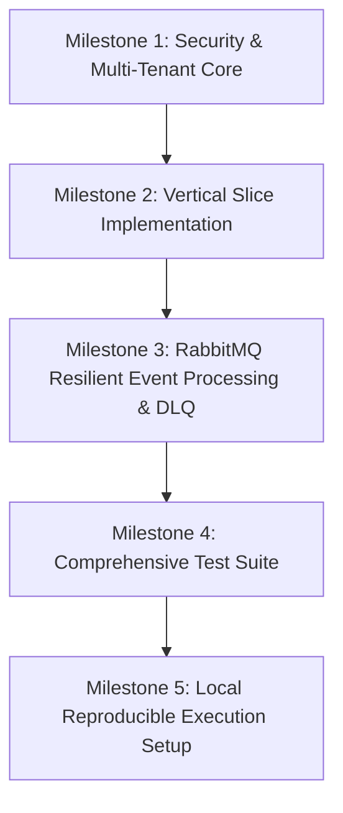

# QuantArth Financial Intelligence Platform (FIP)
## Foundation MVP Implementation Plan & Architectural Audit

**Document Version**: 1.0.0  
**Date**: 2026-10-25  
**Author**: Principal Software Architect & Senior Platform Engineer  
**Status**: APPROVED FOR IMPLEMENTATION

---

## 1. Executive Summary & Audit Findings

An exhaustive audit of the QuantArth Financial Intelligence Platform repository was performed across documentation (`docs/adr.md`, `README.md`), build configuration (`build.gradle`, subproject gradle files), service source code, migrations, tests, and deployment manifests.

### Key Audit Finding
While the repository has a comprehensive architectural layout, several core ADRs are **documented rather than fully realized**, and critical security vulnerabilities exist regarding multi-tenant data isolation and header trust. Documentation must not be confused with completed production capabilities.

---

## 2. ADR Conformity Matrix

| ADR ID | Documented Intent | Current Implementation Status | Conformity & Gap Analysis |
|---|---|---|---|
| **ADR-001** | Git-backed centralized Config Server with dynamic `/actuator/refresh` | **Missing / Documented Only** | No Spring Cloud Config Server exists. Services read local YAML with hardcoded default JWT secret. Secrets must be externalized via `.env`. |
| **ADR-002** | Eureka service discovery with client-side load balancing | **Missing / Documented Only** | Eureka is not implemented. Gateway uses static DNS (`http://auth-service:8081`). *Recommendation*: Adopt container DNS as an explicit ADR amendment. |
| **ADR-003** | Multi-tenant data isolation using `tenant_id` | **Partially Implemented (Critical Vulnerability)** | `TenantResolver` reads arbitrary `X-Tenant-Id` header from client. Gateway does not strip client headers. Repository queries lack strict tenant scoping. |
| **ADR-004** | Database per Service (`fip_auth`, `fip_plugins`, `fip_events`) | **Fully Conforms** | Separate databases configured in `init-databases.sql` and independent Flyway migration scripts. |
| **ADR-005** | Hexagonal Architecture (Ports and Adapters) | **Partially Conforms** | Hexagonal directory structure exists. Domain models need richer business invariant enforcement and decoupled security adapters. |
| **ADR-006** | RabbitMQ, Asynchronous Events, Retries, and DLQ | **Partially Implemented (Broken DLQ)** | Queues and exchanges exist, but `RabbitMQEventListener` catches and swallows all exceptions, preventing messages from ever reaching the Dead-Letter Queue. |
| **ADR-007** | Dynamic Classloader & Sandboxed Plugin Framework | **Partially Implemented** | Classloader loader implemented with fallback mock. Sandboxed capability permissions are simulated. |
| **ADR-008** | Python FastAPI for ML & Document Intelligence | **Fully Conforms (Foundation Rules Engine)** | Modular FastAPI service with 8 typed endpoints (OCR, YOLO, NER, Classification, Merchant, Category, Recommendation, Confidence). |
| **ADR-009** | JWT Claims Propagation & Gateway-Level RBAC | **Partially Implemented (Security Risk)** | Gateway injects headers, but downstream services lack local security filters (`permitAll()` or missing security). Client-spoofed headers are not stripped at the edge. |
| **ADR-010** | RFC 7807 Problem Details for all errors | **Conforms** | `GlobalExceptionHandler` produces standard Problem Details for domain & validation errors. Needs coverage on downstream auth & 404 filters. |

---

## 3. Architecture Gaps & Security Risks

### Risk 1: Tenant Impersonation & Cross-Tenant Data Leakage (High Severity)
- **Current State**: `TenantResolver` resolves `X-Tenant-Id` directly from client HTTP headers without verifying whether the authenticated user belongs to that tenant.
- **Vulnerability**: An attacker with a valid token from `Tenant A` can send `X-Tenant-Id: Tenant-B` and mutate or access Tenant B's data if repository queries do not enforce tenant ownership.
- **Remediation**:
  1. API Gateway must unconditionally strip any client-supplied `X-Tenant-Id`, `X-User-Subject`, `X-User-Id`, `X-User-Roles`, and `X-User-Permissions` before routing.
  2. Gateway extracts `tenantId` strictly from the signed, validated JWT payload and injects it as a trusted downstream header.
  3. Downstream services must extract tenant context exclusively from the trusted identity context and enforce `WHERE tenant_id = :tenantId` on all database operations.

### Risk 2: Silent Message Loss & Ineffective Dead-Letter Exchange (Medium Severity)
- **Current State**: `RabbitMQEventListener.java` contains a generic `catch (Exception e)` block that logs the failure and returns normally.
- **Vulnerability**: RabbitMQ treats the message as successfully processed and acknowledges it (`ACK`). Poison pill messages or downstream database failures will **never** be routed to the dead-letter queue (`fip.dlq`), causing silent data loss.
- **Remediation**:
  1. Remove exception-swallowing in listeners. Allow retriable exceptions to propagate to Spring AMQP's listener container.
  2. Configure bounded retry policy (e.g., 3 attempts with backoff).
  3. Route permanently failed messages to `fip.dlx.exchange` $\rightarrow$ `fip.dlq`.

### Risk 3: Hardcoded Secrets in Source Control (High Severity)
- **Current State**: Default JWT secret (`9a2f3f4g...`) and database passwords exist in `application.yml` and `docker-compose.yml`.
- **Remediation**:
  1. Externalize all secrets into `.env` (with `.env.example` in source control containing dummy placeholders).
  2. Application configurations must require environment variables with no insecure production defaults.

---

## 4. End-to-End Vertical Slice Definition (Phase 2)

To demonstrate a complete, robust production-ready slice without introducing dummy services:

```
[Client]
   │
   │ 1. POST /api/v1/auth/login (username, password)
   ▼
[API Gateway :8080] ──> [Auth Service :8081] ──> Returns JWT with claims (tenantId, roles, permissions)
   │
   │ 2. POST /api/v1/events/publish (Bearer JWT, payload)
   ▼
[API Gateway :8080]
   │ - Strip untrusted headers
   │ - Validate JWT signature & expiration
   │ - Inject trusted headers: X-Tenant-Id, X-User-Subject, X-User-Roles
   │ - Rate limit verification
   ▼
[Event Engine :8083]
   │ - Security filter verifies X-User-Roles / permissions
   │ - TenantContext populated from trusted gateway header
   │ - Business UseCase: Create Tenant-Scoped Financial Event / Document Job
   │ - Repository enforces tenant ownership (tenant_id = :tenantId)
   │ - Save to PostgreSQL (fip_events)
   │ - Publish CanonicalEvent to RabbitMQ (fip.financial.exchange)
   ▼
[RabbitMQ Broker]
   │ - Route to fip.audit.queue
   ▼
[Event Engine Listener]
   │ - Idempotently consume & process event
   │ - On failure: retry 3 times -> reject to fip.dlx.exchange -> fip.dlq
   ▼
[Client Response]
   201 Created with StandardResponse<FinancialEvent>
```

---

## 5. Implementation Roadmap & Dependency Order



### Milestone 1: Security & Multi-Tenant Core
- **Modules**: `api-gateway`, `common-library`
- **Files**:
  - `api-gateway/.../JwtValidationFilter.java`: Strip client spoof headers, extract tenant from JWT.
  - `common-library/.../TenantResolver.java`: Read strictly from trusted gateway header.
  - `common-library/.../TenantContext.java`: ThreadLocal management.
- **Acceptance Criteria**:
  - Client-supplied `X-Tenant-Id` header is stripped and overwritten by the verified JWT `tenantId` claim.
  - Requests missing or carrying expired JWTs receive RFC 7807 401 Unauthorized Problem Details.

### Milestone 2: Vertical Slice Implementation
- **Modules**: `event-engine`, `auth-service`
- **Files**:
  - `event-engine/.../SecurityConfig.java`: Downstream authentication filter validating gateway-propagated identity and RBAC.
  - `event-engine/.../EventIngestionService.java`: Enforce tenant isolation and business rules.
  - `event-engine/.../FinancialEventJpaRepository.java`: Parameterized tenant queries (`findByEventIdAndTenantId`).
  - `event-engine/.../EventController.java`: Standardized RFC 7807 responses on validation/authorization failures.
- **Acceptance Criteria**:
  - User from Tenant A cannot access Tenant B's events (`404 Not Found` or `403 Forbidden`).
  - Role-based authorization (`ROLE_ANALYST`, `ROLE_ADMIN`) enforced.
  - Validation failures return RFC 7807 400 with detailed error maps.

### Milestone 3: Resilient Event Processing & Dead-Letter Handling
- **Modules**: `event-engine`, `shared-contracts`
- **Files**:
  - `event-engine/.../RabbitMQConfig.java`: Retry interceptors, DLQ dead-letter exchange bindings.
  - `event-engine/.../RabbitMQEventListener.java`: Remove exception swallowing; throw non-recoverable exceptions to trigger DLQ.
  - `event-engine/src/main/resources/application.yml`: Configure retry backoff.
- **Acceptance Criteria**:
  - Duplicate events are skipped safely via idempotency check.
  - Poison pill message is retried 3 times and landed in `fip.dlq` without silent loss.

### Milestone 4: Automated Testing Suite
- **Modules**: `auth-service`, `event-engine`, `api-gateway`
- **Files**:
  - Unit & Integration test classes covering JWT verification, RBAC, tenant cross-access denial, DLQ routing, and RFC 7807 validation responses.
- **Acceptance Criteria**:
  - All tests execute and pass cleanly.

### Milestone 5: Local Reproducible Execution & Environment Security
- **Files**:
  - `.env.example`
  - `docker-compose.yml` updated with environment variable substitutions.
  - `README.md` updated with exact verified startup commands.
- **Acceptance Criteria**:
  - No secrets in source code.
  - System starts reproducibly with `docker compose up -d`.

---

## 6. ADR Amendment Proposals

1. **ADR-001 Amendment**: Centralized configuration via Git is deferred post-MVP. Foundation MVP utilizes secure externalized environment variables (`.env`) injected via Docker/System properties.
2. **ADR-002 Amendment**: Service Discovery via Netflix Eureka is replaced by Docker/Kubernetes native DNS service resolution. This eliminates the operational fragility and resource footprint of an unnecessary Eureka server container.
