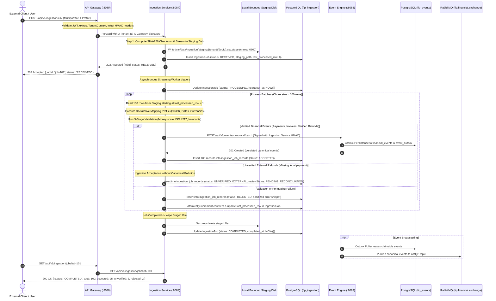

# QuantArth Financial Intelligence Platform (FIP)
## Milestone 4A Architecture Design: Financial Data Ingestion Architecture & Technical Design (Refined)

### 1. Executive Summary & Context

The QuantArth Financial Intelligence Platform (FIP) has successfully established:
- **M1**: Core foundation, shared modular build, multi-tenant context, and gateway infrastructure.
- **M2A & M2B**: Zero-trust gateway security, internal HMAC signature mesh, sliding-window replay protection, transactional outbox with publisher confirmations, and containerized CI/CD.
- **M3A**: Canonical domain models across nine core financial entities (`Payment`, `Transfer`, `Salary`, `Refund`, `Loan`, `LoanRepayment`, `Invoice`, `Subscription`, `Tax`) with arbitrary-precision `Money`, strict ISO 4217 currencies, and PII masking.
- **M3B**: Canonical PostgreSQL JSONB persistence, database-level idempotency constraints, row-level pessimistic locking for refund integrity, transactional outbox atomicity, and normalized AMQP routing (`financial.events.<entity>.<action>`).

**Milestone M4A** designs the next foundational capability: **Financial Data Ingestion**.

#### Product Vision and Responsibility Boundaries
QuantArth is a **Financial Intelligence Platform**, not a payment gateway, payment processor, or core banking ledger. Its purpose is to ingest, validate, normalize, audit, index, and analyze financial data originating from external applications, banking portals, payment processors, and accounting systems.

QuantArth does not:
- Execute fund movements or initiate bank transfers.
- Authorize or disburse merchant refunds.
- Maintain authoritative bank balances.
- Act as an acquiring or issuing payment switch.

Because financial records originate in external systems outside QuantArth’s direct control, the ingestion architecture must rigorously distinguish between **source-reported data** (what an external export or client claims occurred) and **independently verified financial data** (what has been reconciled against authoritative local event history).

---

### 2. Microservice Boundary Evaluation: Option A vs. Option B

A foundational architectural decision for M4 is whether to implement ingestion capabilities within the existing `event-engine` (Option A) or introduce a dedicated microservice named `ingestion-service` (Option B).

```
                      Option A: Monolithic Extension
             +----------------------------------------------+
             |                 event-engine                 |
             |  +--------------------+ +-----------------+  |
             |  | Ingestion & ETL    | | Canonical Event |  |
             |  | CSV/JSON Parsers   | | Persistence     |  |
             |  | Source Mappings    | | Tx Outbox       |  |
             |  | Job Tracking DB    | | RabbitMQ Pub    |  |
             |  +--------------------+ +-----------------+  |
             +----------------------------------------------+

                   Option B: Dedicated Ingestion Service (Approved)
+-----------------------+                    +-----------------------+
|   ingestion-service   |     Internal       |     event-engine      |
|  - CSV/JSON Streaming |     REST Mesh      |  - Canonical Store    |
|  - Bounded Staging    | -----------------> |  - Tx Outbox          |
|  - Mapping Engine     |   POST /canonical  |  - RabbitMQ Pub       |
|  - 3-Stage Validation |     (with HMAC)    |  - Row-Level Locks    |
|  - Job Tracking DB    |                    |  - Financial Events DB|
+-----------------------+                    +-----------------------+
```

#### Detailed Multi-Criteria Comparison Matrix

| Evaluation Dimension | Option A: Extend `event-engine` | Option B: Dedicated `ingestion-service` | Architectural Assessment |
|---|---|---|---|
| **1. Separation of Responsibilities** | **Poor.** Blends dirty external schema transformation, multipart CSV streaming, and ephemeral job status tracking with the pristine canonical event ledger and transactional outbox. | **Superior.** Pure Hexagonal separation: `ingestion-service` handles ingestion ETL and source translation; `event-engine` acts strictly as the immutable canonical event store. | Option B cleanly isolates untrusted external data translation from trusted financial ledger operations. |
| **2. Blast Radius & Fault Isolation** | **High Risk.** A memory spike during parsing of a 25MB malformed CSV or CPU exhaustion in a complex regex parser can crash or stall `event-engine`, halting transactional outbox publishing and event consumers. | **Isolated.** OOMs, file parsing failures, and slow client multipart uploads are confined to `ingestion-service`. The core event streaming backbone remains 100% available. | Option B prevents ingestion workloads from degrading platform event delivery. |
| **3. Scalability & Resource Allocation** | **Constrained.** Must scale the entire event engine (including database connections and outbox pollers) to handle compute-heavy file parsing spikes. | **Elastic.** Ingestion nodes can be independently scaled horizontally (or run with higher heap limits) during month-end batch upload windows. | Option B provides targeted resource scaling. |
| **4. Database Isolation (ADR-004)** | **Violates Principle.** Requires mixing ephemeral job tracking tables (`ingestion_jobs`, `ingestion_job_records`, `source_mappings`) with permanent financial event tables in `fip_events`. | **Compliant.** `ingestion-service` owns its private `fip_ingestion` PostgreSQL database. Ingestion data has a configurable 30–90 day retention policy; financial events have a 10-year immutable audit lifecycle. | Option B aligns with QuantArth ADR-004 (Database-Per-Service). |
| **5. Multi-Tenant Security** | **Moderate.** Tenant context is shared across parsing and persistence threads in the same process. | **Strong.** Ingestion validates tenant boundaries, maps to canonical format, and signs inter-service requests with Gateway HMAC headers (`X-Tenant-Id`, `X-Gateway-Signature`). | Option B enforces defense-in-depth across service boundaries. |
| **6. Reuse of Existing Code** | **High.** Direct in-memory function calls to existing service methods. | **High.** Reuses `shared-contracts` (`CanonicalEvent`, `Payment`, `Money`, `RequestHmacSigner`), `common-library` (`TenantContext`, `AuditModel`), and `event-engine`’s already implemented `POST /api/v1/events/canonical/batch` endpoint. | Both options achieve high code reuse via shared libraries. |
| **7. Solo-Founder Dev Efficiency** | **Marginally Lower Initial Setup.** Avoids configuring one new Spring Boot project and Docker service. | **High Long-Term Agility.** Modular service with dedicated integration tests. Changes to CSV parsing libraries or mapping engines never risk destabilizing existing M3B persistence tests. | Option B provides superior test isolation and safety. |
| **8. Operational Footprint** | ~350MB RAM (single JVM). | ~650MB RAM across two JVMs in local Docker Compose. | Fully feasible within standard developer machines (16GB RAM). |
| **9. Long-Term Extensibility** | Difficult to add specialized connectors (Account Aggregator, bank SFTP pollers, Webhook receivers) without bloating core event engine. | Readily extensible: new connectors and source adapters plug directly into `ingestion-service` without touching core persistence. | Option B enables modular adapter growth. |

#### Architectural Decision
**QuantArth adopts Option B: Dedicated `ingestion-service`.**
The separation between **untrusted external data ingestion/normalization** and **canonical financial event storage/publishing** is a foundational boundary in enterprise fintech architecture. `ingestion-service` acts as an adapter and filter, transforming heterogeneous external financial feeds into validated `CanonicalEvent` instances before passing them to `event-engine` via its existing `POST /api/v1/events/canonical/batch` API.

---

### 3. End-to-End System Architecture & Data Flow



---

### 4. Financial Data Source Adapters

To handle diverse external financial systems without polluting core domain logic, `ingestion-service` defines a generic **Source Adapter Interface**:

```java
public interface SourceAdapter<T> {
    SourceType getSourceType();
    IngestionStream<SourceRecord> parse(InputStream inputStream, IngestionContext context) throws IngestionParsingException;
}
```

#### 4.1 JSON Stream Adapter
- **Purpose**: Ingest structured financial JSON payloads from partner webhook feeds, merchant ERPs, or internal microservices.
- **Processing Mode**:
  - Small payloads ($\le 50$ records): Synchronously validated and ingested within standard HTTP request lifecycle (`POST /api/v1/ingestion/json?sync=true`).
  - Large payloads ($> 50$ records up to 10,000 records): Processed asynchronously with chunked streaming using Jackson `MappingIterator` to maintain constant $O(1)$ memory overhead.

#### 4.2 CSV Stream Adapter
- **Purpose**: Parse external bank statements, payment gateway settlement summaries, invoice spreadsheets, and payroll registers.
- **Parsing Engine**: Fast, memory-efficient RFC 4180 compliant streaming parser (Apache Commons CSV).
- **Security & Format Guards**:
  - Max file size ceiling: **25 MB**.
  - Max record ceiling: **50,000 rows**.
  - Character encoding verification: UTF-8 with automatic BOM stripping.
  - Formula Injection Protection: Leading characters (`=`, `+`, `-`, `@`, `\t`, `\r`) in source values are sanitized to prevent CSV injection vulnerabilities during error report downloads.

#### 4.3 Declarative Source Mapping Engine
Source data formats vary wildly between institutions:
- HDFC Bank: Date format `dd/MM/yyyy`, columns `Withdrawal Amt.` / `Deposit Amt.`
- ICICI Bank: Date format `dd-MM-yyyy`, single `Amount` column with `Type` (`DR`/`CR`)
- Stripe / Razorpay: Amounts in integer cents/paise (e.g. `10000` = ₹100.00), timestamps in epoch seconds.

Rather than hardcoding bank formats in Java classes, M4 introduces **Declarative Mapping Profiles** stored in `source_mapping_profiles`:

```json
{
  "profileId": "prof-hdfc-stmt-v1",
  "name": "HDFC Corporate Bank Statement",
  "sourceType": "CSV",
  "targetEntityType": "PAYMENT",
  "delimiter": ",",
  "hasHeader": true,
  "dateFormat": "dd/MM/yyyy",
  "timezone": "Asia/Kolkata",
  "currencyDefault": "INR",
  "fieldMappings": {
    "entityId": { "sourceColumn": "Chq./Ref.No." },
    "occurredAt": { "sourceColumn": "Date", "transform": "DATE_PARSE" },
    "amount": {
      "strategy": "SPLIT_DR_CR",
      "debitColumn": "Withdrawal Amt.",
      "creditColumn": "Deposit Amt.",
      "scale": 2
    },
    "payerName": { "sourceColumn": "Narration", "transform": "REGEX_EXTRACT", "regex": "UPI/(.*?)/" },
    "status": { "staticValue": "COMPLETED" },
    "paymentMethod": { "staticValue": "BANK_TRANSFER" }
  }
}
```

---

### 5. Multi-Stage Validation Pipeline

Validation is organized into three distinct, non-overlapping architectural stages:

```
  +-----------------------------------------------------------------------+
  |              Stage 1: Source Structural Validation                     |
  |  - File size & record count bounds (< 25MB, < 50k rows)               |
  |  - Encoding (UTF-8) & CSV delimiter integrity                         |
  |  - Required source headers presence                                    |
  +-----------------------------------+-----------------------------------+
                                      | Valid Records
                                      v
  +-----------------------------------------------------------------------+
  |              Stage 2: Canonical Domain Invariant Validation            |
  |  - Exact Money scale (scale <= 6, Bankers' Rounding HALF_EVEN)         |
  |  - ISO 4217 Currency validation                                        |
  |  - FinancialParty & FinancialReference format integrity                |
  |  - Temporal ordering: occurredAt <= recordedAt                         |
  |  - Entity invariants (FinancialModelValidator)                         |
  +-----------------------------------+-----------------------------------+
                                      | Valid Entities
                                      v
  +-----------------------------------------------------------------------+
  |              Stage 3: Business Consistency & Reconciliation            |
  |  - Multi-tier duplicate checks (Advisory file hash, Source TXN ID)     |
  |  - External Refund Ancestry Analysis (Verified vs Unverified External) |
  |  - Cross-row consistency in batch uploads                              |
  +-----------------------------------------------------------------------+
```

---

### 6. External Refund Handling Architecture & Reconciliation Workflow

#### 6.1 Inspection of M3B Refund Validation Behavior
Inspection of `event-engine`'s `RefundIntegrityValidator.java` reveals the existing handling:
- When a refund is ingested directly into `event-engine`:
  1. It performs pessimistic locking via `findPaymentForUpdate(tenantId, paymentId)`.
  2. If the payment exists locally: it enforces currency matching, non-terminal payment status, individual refund amount $\le$ captured amount, and cumulative refunds $\le$ payment capacity.
  3. If the payment record is **absent** from `eventStorePort`: lines 120–133 log that the payment was not found and validate the refund amount against the payload's `originalPaymentAmount` ceiling if declared.
  4. Once validated, `event-engine` persists the refund into `financial_events`.

#### 6.2 The Architectural Risk & Distinction: Ingestion Acceptance vs. Canonical Acceptance
Persisting an unverified external refund directly into `financial_events` as an authoritative ledger event introduces financial risks:
- Downstream intelligence engines would treat unverified claims as verified, audited ledger entries.
- If cumulative refunds for an external payment arrive across multiple spreadsheets, the local ledger cannot lock or verify cumulative capacity against an absent payment.
- To maintain accounting integrity, QuantArth strictly distinguishes **Ingestion Acceptance** from **Canonical Ledger Acceptance**:
  - **Do NOT Fabricate Original Payments**: Synthetic dummy payments create false ledger entries.
  - **Do NOT Weaken M3B Canonical Rules**: Canonical events must remain strictly audited.
  - **Retain in Ingestion Review State**: Unverified refunds are accepted into `ingestion-service`'s `ingestion_job_records` store with status `UNVERIFIED_EXTERNAL` and review state `PENDING_RECONCILIATION`. They are **NOT** immediately forwarded to `event-engine` as canonical events.

#### 6.3 Status Lifecycle & Reconciliation Transitions

```
[External Refund Ingested]
           |
           v
  {Original Payment Exists in Ledger?}
      /                        \
    YES                         NO
    /                             \
[M3B Pessimistic Lock & Cap Check] [Ingestion Acceptance Only]
           |                                  |
   (Passed Validation)                        v
           |                   Status: UNVERIFIED_EXTERNAL
           v                   Review: PENDING_RECONCILIATION
  Forward to Event Engine      Storage: fip_ingestion.ingestion_job_records
  Status: VERIFIED                            |
  Event: financial_events                     |
                                +-------------+-------------+
                                |                           |
                                v                           v
                   [Historical Payment Ingested]   [Operator Approval API]
                   Automated Ledger Match          Manual Reconciliation
                                |                           |
                                +-------------+-------------+
                                              |
                                              v
                               Transition to RECONCILED_VERIFIED
                               Forward to event-engine (M3B lock)
                               Persist in financial_events
```

- **Transition Rules**:
  1. `UNVERIFIED_EXTERNAL` $\to$ `RECONCILED_VERIFIED`:
     - *Trigger A (Automated)*: Subsequent ingestion of historical payment matching `originalPaymentReference`. Ingestion service reconciliation listener detects matching payment, acquires capacity lock, forwards the refund to `event-engine`, and marks the record `RECONCILED_VERIFIED`.
     - *Trigger B (Manual)*: Authorized financial operator approves the unverified refund via `POST /api/v1/ingestion/reconciliation/refunds/{recordId}/approve` with audit reason code `HISTORICAL_EXTERNAL_PRE_QUANTARTH`.
  2. `UNVERIFIED_EXTERNAL` $\to$ `REJECTED`:
     - Duplicate external refund detected or reconciliation rejected by operator.

---

### 7. CSV Upload Durability, Staging, and Restart Recovery

#### 7.1 Resolving the Asynchronous vs. Durability Contradiction
Asynchronous processing (`POST /api/v1/ingestion/csv` returning `202 Accepted`) cannot be paired with "zero disk persistence." If an application node crashes during a 30-second CSV parsing loop, in-memory buffers are lost, preventing restart recovery.

To achieve restart durability at minimal cost without paid cloud infrastructure (S3/GCS):
1. **Bounded Ephemeral Staging Volume**:
   - Ingestion service streams multipart uploads directly to a dedicated local directory:
     `/var/data/ingestion/staging/{tenant_id}/{job_id}.csv.stage`
   - Linux file permissions: `chmod 0600` (read/write only by the `fip` application UID).
   - Storage limits: Hard cap of 25 MB per file; max staging partition size 10 GB. If storage threshold exceeds 80%, reject incoming uploads with HTTP `507 Insufficient Storage`.
2. **Resumable Progress Tracking**:
   - `ingestion_jobs` tracks:
     - `staging_file_path`: Path to staged file.
     - `last_processed_row`: Monotonically increasing counter of the last successfully processed and committed record index (e.g. 1400).
     - `heartbeat_at`: Updated by worker thread on every batch commit.
     - `retry_count`: Incremented on recovery restarts.
3. **Application Restart Recovery Algorithm**:
   - On application startup, `IngestionRestartRecoveryRunner` scans `ingestion_jobs` for jobs with `status = 'PROCESSING'` and `heartbeat_at < NOW() - 5 minutes`.
   - **Single-Node Deployment (MVP / Docker Compose)**:
     - The staged file is preserved across container restarts via Docker named volume `ingestion_staging`.
     - The recovery worker reopens `/var/data/ingestion/staging/{tenant_id}/{job_id}.csv.stage`, skips rows $1 \dots \text{last\_processed\_row}$, and resumes streaming from $\text{last\_processed\_row} + 1$.
     - Because rows $1 \dots \text{last\_processed\_row}$ were already persisted in `fip_events` and `ingestion_job_records`, **zero duplicate canonical events are produced**.
   - **Multi-Node Deployment Limitations (Documented)**:
     - In a distributed multi-node environment without a shared POSIX filesystem (e.g. NFS / AWS EFS), Node B cannot access a local file staged on Node A.
     - *Explicit Architecture Contract*: For multi-node deployments, either:
       (a) Workers acquire job leases with node affinity matching the staging node, or
       (b) Staging volume is mounted as a shared network filesystem (ReadWriteMany PVC), or
       (c) In the absence of shared storage, interrupted jobs on a crashed node transition to `FAILED` with error code `NODE_RESTART_FILE_UNAVAILABLE`, instructing the client to re-upload.
     - For the MVP, single-node Docker volume provides 100% durable restart recovery.
4. **Secure Wipe & Cleanup**:
   - Immediately upon reaching terminal status (`COMPLETED`, `PARTIALLY_COMPLETED`, or `FAILED`), the staged file is securely overwritten and unlinked.
   - A scheduled cleanup job (`StagingCleanupScheduler`) purges any orphaned `.stage` files older than 24 hours.

---

### 8. Multi-Boundary Deduplication & Advisory File Fingerprinting

#### 8.1 Reevaluation of `(tenant_id, file_hash)` Unique Constraint
The previous proposal enforced a hard PostgreSQL unique constraint on `(tenant_id, file_hash)`. This caused operational failures:
- Prevented re-uploading a file after an initial ingestion failed midway.
- Prevented re-processing a file after a user updated their mapping profile.
- Prevented intentional re-ingestion when a client requested a force-reprocess.

**Revised Decision**:
- Remove the database UNIQUE constraint on `(tenant_id, file_hash)`.
- Replace with a standard B-tree index `idx_ingestion_jobs_tenant_file_hash`.
- Move duplicate file detection into domain service logic with explicit override controls.

#### 8.2 The 4-Tier Deduplication Hierarchy

```
+-------------------------------------------------------------------------------+
| Tier 1: HTTP Request Idempotency                                               |
| Scope: (tenant_id, Idempotency-Key header)                                     |
| Mechanism: 24-hour Redis/Database idempotency cache. Identical retries return  |
| identical 202 Accepted response without re-executing parsing or staging.       |
+-------------------------------------------------------------------------------+
                                      |
                                      v
+-------------------------------------------------------------------------------+
| Tier 2: Upload File Fingerprinting (Advisory Policy)                           |
| Scope: (tenant_id, file_hash, mapping_profile_id, mapping_profile_version)     |
| Policy: If identical file_hash was COMPLETED with same mapping profile:       |
|   - Default: Reject with RFC 7807 409 Conflict (Duplicate File Upload).       |
|   - Exception A: If previous job FAILED -> Allow re-upload.                   |
|   - Exception B: If mapping_profile_version changed -> Allow re-processing.   |
|   - Exception C: If client specifies query param `force=true` -> Allow.       |
+-------------------------------------------------------------------------------+
                                      |
                                      v
+-------------------------------------------------------------------------------+
| Tier 3: Source Transaction Identity                                           |
| Scope: (tenant_id, source_system, source_record_id)                            |
| Mechanism: Checked during record normalization. If a source transaction was    |
| previously accepted, it is flagged as DUPLICATE in ingestion_job_records and  |
| skipped from canonical forwarding.                                            |
+-------------------------------------------------------------------------------+
                                      |
                                      v
+-------------------------------------------------------------------------------+
| Tier 4: Canonical Event Idempotency (ACID Ledger Boundary)                    |
| Scope: (tenant_id, source_system, idempotency_key) in fip_events               |
| Mechanism: M3B composite unique index. Identical event payloads return         |
| idempotent 200 OK. Key reuse with altered payload returns 409 Conflict.        |
+-------------------------------------------------------------------------------+
```

---

### 9. Internal Service Authentication & Secure Service Identity

#### 9.1 Inspection of Gateway and HMAC Architecture
Inspection of M2A contracts reveals:
- `RequestHmacSigner.java` in `shared-contracts` implements RFC-compliant HMAC-SHA256 request authentication binding `method`, `path`, `query`, `subject`, `userId`, `tenantId`, `roles`, `timestamp`, `nonce`, and `bodyDigest`.
- `GatewayAuthenticationFilter.java` in `event-engine` inspects `X-Gateway-*` headers, performs constant-time signature verification against `${GATEWAY_INTERNAL_SECRET}`, checks clock skew ($\le 60\text{s}$), prevents replay attacks via sliding-window nonces, and binds `TenantContext`.

#### 9.2 Ingestion-Service Identity & Signing Arrangement
`ingestion-service` does NOT spoof or reuse gateway-only credentials. It possesses its own distinct internal service identity while using the standard M2A HMAC signing mechanism:
- **Service Identity Context**:
  - `X-User-Subject`: `service:ingestion-service`
  - `X-User-Id`: `system:ingestion-service`
  - `X-User-Roles`: `ROLE_INTERNAL_SERVICE`
  - `X-Tenant-Id`: Propagated from the authenticated tenant initiating the ingestion job (preserving strict tenant isolation).
- **Cryptographic Signing**:
  - `ingestion-service` configures `RequestHmacSigner` from `shared-contracts`.
  - Uses internal mesh secret `${GATEWAY_INTERNAL_SECRET}` and `activeKeyId = "v1"`.
  - Computes `X-Gateway-Body-Digest` over the canonical batch JSON payload.
  - Generates unique UUID `X-Gateway-Nonce` and UTC timestamp.
- **Why this adheres to M2A**:
  - Zero code modifications required in `event-engine` or `shared-contracts`.
  - Every batch request from `ingestion-service` is cryptographically authenticated, bound to the tenant, tamper-proof, and audit-logged under service identity `service:ingestion-service`.

---

### 10. Database Simplicity, Configurable Retention & Audit Preservation

#### 10.1 Removal of Monthly Table Partitioning
The initial proposal specified monthly range partitioning on `ingestion_job_records`.
- *Refinement*: Partitioning is unnecessary for MVP scale ($< 10\text{M}$ records) and introduces DDL operational overhead (dynamic partition creation, complex indexing, Flyway migration hazards).
- *Decision*: Use ordinary PostgreSQL tables with composite B-tree indexes on `(tenant_id, created_at)` and `(job_id, status)`.

#### 10.2 Configurable Retention Policies
Retention is externalized in configuration rather than hardcoded:
```yaml
ingestion:
  retention:
    records-days: ${INGESTION_RECORDS_RETENTION_DAYS:90}
    jobs-days: ${INGESTION_JOBS_RETENTION_DAYS:365}
    staging-cleanup-hours: 24
```
- **90-Day Record Retention & 10-Year Canonical Retention**: Treated as proposed baseline policies requiring future enterprise regulatory confirmation, not universal mandates.

#### 10.3 Chunked Off-Peak Pruning & Permanent Audit Metadata
- **Scheduled Pruner (`IngestionDataPruningScheduler`)**:
  - Runs daily during off-peak hours (02:00 UTC).
  - Deletes expired rows from `ingestion_job_records` in bounded chunks (1,000 rows per transaction) to prevent table locking and transaction log bloat:
    ```sql
    DELETE FROM ingestion_job_records
    WHERE record_id IN (
        SELECT record_id FROM ingestion_job_records
        WHERE created_at < NOW() - INTERVAL '90 days'
        LIMIT 1000
    );
    ```
- **Minimum Audit Metadata that Must Survive Record Deletion**:
  Even after detailed row-level error records in `ingestion_job_records` are pruned, the parent record in `ingestion_jobs` is preserved for 1 year (or indefinitely):
  - `job_id`, `tenant_id`, `source_type`, `source_system`, `source_name`, `file_hash`, `mapping_profile_id`, `mapping_profile_version`.
  - `total_records`, `accepted_records`, `unverified_records`, `rejected_records`, `duplicate_records`.
  - `started_at`, `completed_at`, `created_by`.
  - `error_summary`: JSON aggregate summary of error codes and counts (e.g. `{"INVALID_CURRENCY": 2, "DUPLICATE_TXN": 5}`).
  This satisfies statutory audit requirements without retaining sensitive row-level financial PII.

---

### 11. Resilience, Money Precision & Batch Fallback Mechanics

#### 11.1 Money Precision & Banker's Rounding
- Ingestion mapping parses amounts using exact `BigDecimal`.
- Currency scale enforced: standard fiat (INR, USD, EUR) scaled to 2 decimal places using Banker's Rounding (`RoundingMode.HALF_EVEN`). Crypto/micro-fee currencies support scale up to 6.
- Floating-point `float` or `double` are strictly prohibited.

#### 11.2 Atomic Status Counters
Counters in `ingestion_jobs` are never calculated in-memory and written back. They are updated atomically in PostgreSQL:
```sql
UPDATE ingestion_jobs
SET accepted_records = accepted_records + :chunkAccepted,
    unverified_records = unverified_records + :chunkUnverified,
    rejected_records = rejected_records + :chunkRejected,
    duplicate_records = duplicate_records + :chunkDuplicate,
    last_processed_row = :lastRow,
    heartbeat_at = CURRENT_TIMESTAMP
WHERE job_id = :jobId;
```

#### 11.3 Batch Fallback Isolation
When sending a chunk of 100 canonical events to `event-engine` via `POST /api/v1/events/canonical/batch`:
- If `event-engine` returns an unexpected 400/409 error on the batch, `ingestion-service` automatically falls back to **row-by-row dispatch** for that specific chunk.
- The single invalid row is isolated, flagged as `REJECTED` in `ingestion_job_records`, and the remaining 99 valid rows succeed and commit.

---

### 12. Architectural Decision Summary (M4A)

| Issue | Previous Proposal | Refined Decision | Justification |
|---|---|---|---|
| **Service Boundary** | Dedicated `ingestion-service` | Dedicated `ingestion-service` (Approved) | Clean isolation of dirty ETL parsers from canonical event store. |
| **External Refunds** | Ingest into canonical store with unverified metadata | Ingestion-side holding in `ingestion_job_records` (Status: `UNVERIFIED_EXTERNAL`) | Preserves canonical ledger purity; does not fabricate dummy payments; enables reconciliation. |
| **CSV Upload Durability** | Zero raw file storage | Bounded local staging volume (`/var/data/ingestion/staging`) with resumable `last_processed_row` | Resolves async vs durability contradiction; enables single-node crash recovery without paid cloud. |
| **File Deduplication** | Hard unique constraint on `(tenant_id, file_hash)` | Advisory domain check; allow re-upload on failure, mapping change, or `force=true` | Eliminates database blocks on legitimate file re-processing. |
| **Table Partitioning** | Mandatory monthly range partitioning | Ordinary PostgreSQL tables with composite indexes | Simplifies MVP; eliminates DDL partition management overhead. |
| **Internal Auth** | Assumed gateway credentials | Dedicated service identity (`service:ingestion-service`) signed via `RequestHmacSigner` | 100% compliant with M2A HMAC security mesh without modifying `event-engine`. |
| **Record Retention** | Fixed 90-day retention | Configurable retention with perpetual summary audit metadata | Balances privacy compliance with enterprise regulatory flexibility. |
